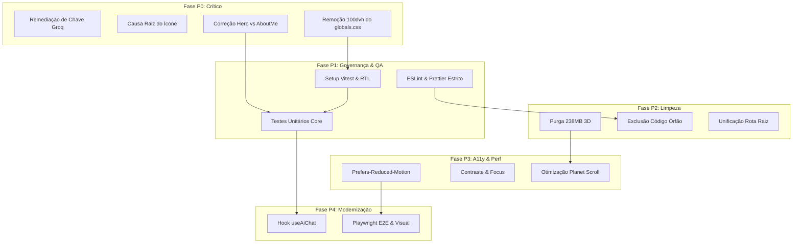

# Relatório de Auditoria Técnica e Roadmap de Modernização Arquitetural

> **Projeto**: Portfólio Pessoal & Hub de Engenharia de Software  
> **Perfil do Desenvolvedor**: Anderson Rodrigues (Full Stack / Frontend Specialist / AI & MCP Engineer)  
> **Papel**: Senior Software Architect & Frontend Quality Engineer  
> **Data da Auditoria**: Novembro de 2026  
> **Repositório**: `new-portifolio`  
> **Status**: Auditoria Concluída / Aguardando Aprovação para Execução  

---

## 1. Resumo Executivo

O presente documento consolida uma auditoria técnica completa, exaustiva e não destrutiva do repositório `new-portifolio`. O projeto possui aproximadamente 6 anos de evolução contínua, transitando por múltiplos paradigmas do ecossistema React/Next.js até sua configuração atual em **Next.js 14 (App Router)** com exportação estática (`output: "export"`) voltada ao **GitHub Pages**.

### 1.1 Diagnóstico Geral
O projeto destaca-se por uma **identidade visual marcante, elegante e autoral**, fundamentada em *dark glassmorphism*, paleta espacial/neon (tons de azul profundo, ciano `#00f5ff`, violeta e esmeralda), canvas 3D interativo com Three.js (planeta Terra reagindo ao scroll), partículas estelares (@tsparticles), timeline animada de carreira com feixes de laser contínuos e o módulo pioneiro de **Engenharia de IA & Servidores MCP** com um assistente virtual LLM integrado.

Entretanto, o crescimento orgânico ao longo de meia década acumulou débitos técnicos severos, código órfão, duplicidade de gerenciadores de pacote, ausência absoluta de suíte de testes (0% de cobertura), problemas graves de usabilidade mobile decorrentes de regras CSS globais rígidas, inversão estrutural de seções e uma **vulnerabilidade crítica de segurança** com exposição de chave de API em bundle cliente.

### 1.2 Principais Achados Críticos (Top Issues)

| Severidade | Categoria | Descrição do Problema | Arquivo(s) Afetado(s) |
|---|---|---|---|
| **CRÍTICA (P0)** | **Segurança** | **Exposição de Chave Privada Groq**: Injeção da variável `NEXT_PUBLIC_GROQ_API_KEY` na pipeline do GitHub Actions e instanciação direta do SDK no cliente com `dangerouslyAllowBrowser: true`, permitindo que qualquer visitante extraia a chave em texto plano no console DevTools. | `.github/workflows/deploy-pages.yml`<br>`src/components/chat/ai-chatbox.tsx` |
| **ALTA (P0)** | **Layout & UX** | **Quebra Sistêmica de Scroll e Overflow**: Regra global `section { height: 100dvh; overflow: hidden; }` no `globals.css` que decepa o conteúdo de seções longas (`ai-ecosystem`, `projects`, `contact`, `ai-chat`) em dispositivos móveis e desktops com telas verticais moderadas, além de provocar pulos indevidos de scroll durante o envio de mensagens no chat. | `src/styles/globals.css`<br>`src/components/chat/ai-chat.tsx` |
| **ALTA (P0)** | **Navegação** | **Inversão de Identificadores Hero vs AboutMe**: O componente `about-me.tsx` renderiza `<section id="hero">` e o componente `hero.tsx` renderiza `<section id="about-me">`. Os links da Navbar e a lógica semântica estão invertidos há anos. | `src/components/sections/about-me.tsx`<br>`src/components/sections/hero.tsx`<br>`src/components/navbar.tsx` |
| **ALTA (P0)** | **Assets & Visual** | **Causa Raiz do Ícone Principal Quebrado**: O componente `Logo` referencia `src="/favicon.ico"` de forma estática sem o prefixo `publicAssetPath`, resultando em requisições para `https://eusouanderson.github.io/favicon.ico` (404 Not Found) no GitHub Pages. Além disso, `public/favicon.ico` é fisicamente um PNG 288x288 e o `layout.tsx` não declara `icons` nos metadados. | `src/components/logo.tsx`<br>`src/app/layout.tsx`<br>`public/favicon.ico` |
| **MÉDIA (P1)** | **Qualidade & QA** | **Ausência Total de Testes e Script Enganoso**: Zero arquivos de teste unitário, integração ou E2E no repositório. O comando `pnpm test` executa mascaradamente `next build && next start`. | `package.json` |
| **MÉDIA (P2)** | **Performance & Storage** | **238 MB de Modelos 3D Órfãos**: Presença de arquivos binários 3D pesados (`aventador` ~53MB, `drone` ~63MB, `robot` ~70MB, `nissan_gt-r` ~47MB) nunca carregados pela aplicação em produção. | `public/assets/canvas/*`<br>`src/components/canvas/*` |
| **MÉDIA (P2)** | **Arquitetura** | **Duplicação e Inconsistência de Rotas Raiz**: `src/app/page.tsx` renderiza um `<nav>` rudimentar com iframe de terceiro (`plano-de-ensino-six.vercel.app`), enquanto `src/app/[language]/page.tsx` renderiza a `MainPage` limpa e multilíngue. | `src/app/page.tsx`<br>`src/app/[language]/page.tsx` |

---

## 2. Inventário Tecnológico Completo

### 2.1 Especificações da Stack
- **Framework Web**: Next.js `14.2.35` (App Router, SSG via `output: "export"`)
- **Biblioteca Base**: React `18.3.1` e React DOM `18.3.1`
- **Linguagem**: TypeScript `5.9.3`
- **Ambiente de Execução**: Node.js v20.x LTS / Linux x86_64
- **Gerenciador de Pacotes**: `pnpm` (com resquício de `package-lock.json` e `pnpm-lock.yaml`)
- **Motor CSS**: Tailwind CSS `3.4.10` com `postcss` `8.4.41` e `autoprefixer` `10.4.20`

### 2.2 Dependências de Produção (`dependencies`)

| Pacote | Versão Instalada | Categoria | Finalidade no Projeto | Diagnóstico de Saúde |
|---|---|---|---|---|
| `next` | `14.2.35` | Framework | Roteamento, SSR/SSG, bundling | Atualizado na faixa 14.x. Estável. |
| `react` / `react-dom` | `18.3.1` | Core UI | Renderização declarativa e Virtual DOM | Estável. Compatível com Three.js/Fiber. |
| `three` | `0.166.1` | 3D Graphics | Renderização WebGL do planeta Terra | Funcional. Biblioteca pesada (~600KB uncompressed). |
| `@react-three/fiber` | `8.16.8` | 3D Reconciler | Integração declarativa React + Three.js | Compatível com React 18. |
| `@react-three/drei` | `9.108.4` | 3D Helpers | OrbitControls, Preload, useGLTF | Estável. |
| `framer-motion` | `11.5.4` | Animações | Transições de página, laser timeline, fade-ins | Excelente performance, porém sem suporte a reduced-motion. |
| `@tsparticles/react` | `3.0.0` | Efeitos Visuais | Camada de partículas estelares de fundo | Estável. |
| `@tsparticles/slim` | `3.5.0` | Partículas Core | Pacote otimizado para partículas | Bem dimensionado. |
| `groq-sdk` | `0.5.0` | Inteligência Artificial | SDK de inferência ultra-rápida LLM Groq | Usado incorretamente no frontend com risco de segurança. |
| `openai` | `4.52.0` | Inteligência Artificial | SDK oficial OpenAI | **Órfão**. Não utilizado nos componentes em execução. |
| `swiper` | `11.1.14` | Carrossel | Slider 3D de projetos recentes | Funcional, estilização customizada no `globals.css`. |
| `lucide-react` | `0.428.0` | Ícones | Conjunto de ícones vetoriais modernos | Utilizado nos cards de IA e projetos. |
| `react-icons` | `5.2.1` | Ícones | Pacote amplo de ícones universais | **Sobreposição**. Duplica biblioteca de ícones com Lucide. |
| `sonner` | `1.5.0` | Notificações | Toast notifications estilizadas | Excelente lib, leve e acessível. |
| `@radix-ui/react-tooltip` | `1.1.2` | Acessibilidade UI | Primitiva de tooltip acessível | Bem integrada via shadcn/ui pattern. |
| `@radix-ui/react-slot` | `1.1.0` | Composição UI | Polimorfismo `asChild` para botões | Essencial para o design system. |
| `clsx` / `tailwind-merge` | `2.1.1` / `2.5.2` | CSS Utilities | Combinação condicional e deduplicação de classes | Padrão ouro na função `cn()`. |
| `hamburger-react` | `2.5.1` | UI Mobile | Botão interativo de menu mobile | Funcional e acessível. |
| `react-dropzone` | `14.2.3` | Formulários | Upload de arquivos por drag and drop | Usado no chatbox para anexar contexto. |
| `canvas-confetti` | `1.9.4` | Efeitos Visuais | Explosão de confetes ao submeter contato | Efeito visual lúdico. |
| `@emailjs/browser` | `4.4.1` | Serviços de Email | Envio de formulário cliente EmailJS | **Órfão**. O formulário ativo usa `formsubmit.co`. |
| `nodemailer` | `6.9.14` | Serviços de Email | Envio SMTP de email em Node.js | **Incompatível / Órfão**. Em `output: "export"`, código Node quebra em runtime. |

### 2.3 Dependências de Desenvolvimento (`devDependencies`)
- `typescript`: `5.9.3` (avançada; requer atenção com ESLint 8)
- `@types/node`: `20.14.9`
- `@types/react`: `18.3.3`
- `@types/react-dom`: `18.3.0`
- `@types/three`: `0.166.0`
- `@types/canvas-confetti`: `1.9.0`
- `eslint`: `8.57.0` (legada)
- `eslint-config-next`: `14.2.4`
- `postcss`: `8.4.41`
- `tailwindcss`: `3.4.10`

---

## 3. Diagnóstico da Arquitetura

### 3.1 Topologia de Diretórios
```
new-portifolio/
├── public/                     # Assets estáticos (238MB de modelos 3D órfãos)
│   ├── assets/canvas/          # aventador, drone, robot, desktop_pc (ÓRFÃOS)
│   │   └── planet/             # Usado pelo Canvas da Terra (earth.tsx)
│   ├── assets/images/          # Avatares, imagens de projetos, bandeiras
│   └── favicon.ico             # PNG 288x288 renomeado para .ico
├── src/
│   ├── app/                    # Rotas Next.js App Router
│   │   ├── [language]/page.tsx # Rota dinâmica SSG (pt-br, en, es)
│   │   ├── planos/page.tsx     # Página secundária com iframe externo
│   │   ├── layout.tsx          # Root Layout com metadados e providers
│   │   └── page.tsx            # Rota raiz com nav redundante
│   ├── components/             # Árvore de componentes
│   │   ├── canvas/             # Componentes Three.js (earth, ball, computer, robot)
│   │   ├── chat/               # Módulo de Chat com LLM Groq
│   │   ├── sections/           # Seções da landing page
│   │   └── ui/                 # Primitivas UI estilo Shadcn
│   ├── contexts/               # Contexto reativo de idioma
│   ├── hooks/                  # Custom hooks (ex: useMediaQuery)
│   ├── lib/                    # Utilitários globais, toast, email
│   ├── styles/                 # globals.css e regras específicas
│   ├── types/                  # Definições de tipagem TypeScript
│   └── utils/                  # Funções auxiliares (downloadFile, publicAssetPath)
```

### 3.2 Desacoplamento e Responsabilidades
1. **Chatbox Monolítico (`src/components/chat/ai-chatbox.tsx`)**:
   - O componente possui **320 linhas de código** acumulando:
     - Renderização da janela de chat e cabeçalho;
     - Streaming de tokens em tempo real via SSE do Groq;
     - Lógica de fallback para resposta estática local com atraso simulado;
     - Formatação e parsing de Markdown;
     - Manipulação de histórico no estado reativo do React;
     - Auto-scroll com `scrollIntoView`;
     - Leitura direta de `process.env.NEXT_PUBLIC_GROQ_API_KEY`.
   - *Violação do Princípio da Responsabilidade Única (SRP)*. A lógica de inferência, streaming e estado de mensagens deve ser extraída para um hook desacoplado `useAiChat()`.

2. **Gargalo no Planeta de Fundo (`src/components/background-planet.tsx`)**:
   - O componente executa `document.getElementById('hero')` e dispara `getBoundingClientRect()` a cada evento de `window.onscroll`.
   - Essa prática força o navegador a recalcular o layout da página a cada frame de rolagem (*Forced Synchronous Layout / Layout Thrashing*), prejudicando diretamente o FID/INP em dispositivos móveis.
   - Deve ser refatorado para utilizar a API nativa de `IntersectionObserver` combinada com `requestAnimationFrame`.

3. **Código Morto e Arquivos Órfãos Mapeados**:

| Arquivo / Diretório | Tamanho | Motivo do Diagnóstico | Ação Recomendada |
|---|---|---|---|
| `public/assets/canvas/drone/` | ~63 MB | Modelo 3D sem qualquer referência no código | Excluir com segurança |
| `public/assets/canvas/robot/` | ~70 MB | Modelo 3D sem qualquer referência no código | Excluir com segurança |
| `public/assets/canvas/aventador/` | ~53 MB | Modelo 3D sem qualquer referência no código | Excluir com segurança |
| `public/assets/canvas/nissan_gt-r_r35_gt_v2.glb` | ~47 MB | Arquivo binário GLB avulso sem uso | Excluir com segurança |
| `public/assets/canvas/desktop_pc/` | ~5 MB | Modelo do antigo hero descartado | Excluir com segurança |
| `src/components/canvas/ball.tsx` | ~2 KB | Componente de bola 3D comentado | Excluir com segurança |
| `src/components/canvas/computer.tsx`| ~3 KB | Componente de computador 3D antigo | Excluir com segurança |
| `src/components/canvas/robot.tsx` | ~3 KB | Componente de robô 3D antigo | Excluir com segurança |
| `src/components/project-list/ProjectList.tsx` | ~8 KB | Antiga listagem de projetos via API do GitHub | Excluir com segurança |
| `src/components/slider-projects.tsx` | ~3 KB | Slider legado substituído por `projects.tsx` | Excluir com segurança |
| `src/components/shiny-button.tsx` | ~2 KB | Botão estilizado órfão | Excluir com segurança |
| `src/styles/shiny-button.css` | ~1 KB | CSS associado ao botão órfão | Excluir com segurança |
| `src/components/icons/check.tsx` | ~1 KB | Ícone SVG avulso não importado | Excluir com segurança |
| `src/components/contact-form/actions.ts` | ~2 KB | Server actions de Nodemailer (inválidas em export) | Excluir com segurança |
| `src/lib/email/` | ~4 KB | Módulos de envio SMTP legados | Excluir com segurança |

---

## 4. Diagnóstico Visual & Identidade

### 4.1 DNA Visual do Projeto (A Preservar Intactamente)
- **Paleta Cromática Central**:
  - `bg-dark-gray`: `#0e0e10` e `#050816` (fundos imersivos profundos)
  - `black-blue`: `#1e1b4b` e gradiente ciano-violeta (`violet-gradient`)
  - Acentos Neon: `#00f5ff` (ciano elétrico), `#a855f7` (violeta), `#10b981` (esmeralda online)
- **Grid de Engenharia**:
  - Padrão linear milimétrico de 48x48px com linhas semitransparentes (`bg-[size:48px_48px]`), evocando precisão técnica e blueprints modernos.
- **Microinterações e Profundidade**:
  - *Dark Glassmorphism*: Painéis com `backdrop-blur-md`, bordas em `border-white/10` e fundos translúcidos em camadas sutis.
  - *Timeline Laser*: A linha de experiência profissional exibe um pulso luminoso contínuo simulando transmissão de dados de alta velocidade via fibra óptica, com nós pulsantes e conexão aos marcos cronológicos desde 2009.
  - *Planeta 3D Interativo*: Terra com relevo, atmosfera e nuvens girando no espaço e transitando de posição conforme o usuário desce a página.
  - *Language Switcher*: Pílula flutuante translúcida com troca instantânea (0ms) e badges de bandeiras sem desmontagem do DOM.

---

## 5. Problemas de Responsividade (320px a 1920px)

### 5.1 O Bug Estrutural do `globals.css`
No arquivo `src/styles/globals.css`, encontra-se a seguinte declaração:
```css
section {
  height: 100dvh;
  scroll-snap-align: center;
  overflow: hidden;
}
```
**Impactos Comprovados**:
1. **Em telas menores que 1080px de altura vertical ou smartphones (320px a 430px)**: Seções que contêm muito conteúdo textual ou grades de cards (como `AiEcosystem`, `Projects`, `Experiences` e `Contact`) excedem 100dvh. Como `overflow: hidden` impede a rolagem interna e a seção tem altura travada, **metade do conteúdo é simplesmente cortada e fica inacessível**.
2. **Conflito no Chatbox**: No mobile, quando o teclado virtual abre ou o chat recebe respostas longas, a seção tenta se ajustar aos `100dvh`. O navegador dispara o `scroll-snap` para o próximo elemento com `scroll-snap-align: center`, fazendo a página "pular" involuntariamente para a seção de Projetos (bug formalmente relatado pelo usuário).

### 5.2 Comportamento Detalhado por Breakpoints

| Resolução | Cenário Típico | Sintomas Diagnosticados | Correção Segura sem Descaracterizar |
|---|---|---|---|
| **320px – 360px** | Smartphones compactos (iPhone SE, Galaxy A antigos) | • `px-12` na seção Hero esmaga o texto central.<br>• Título "Desenvolvedor Full Stack" sobrepõe com leading apertado.<br>• Botões flutuantes (WhatsApp + Idioma) cobrem o rodapé do formulário. | Substituir `h-dvh` fixo por `min-h-dvh py-20`. Reduzir paddings para `px-4 sm:px-8`. Ajustar tamanho do texto de `text-6xl` para `text-3xl sm:text-5xl`. |
| **390px – 430px** | Smartphones modernos (iPhone 14/15/16, Galaxy S24) | • Timeline de experiências fica comprimida horizontalmente.<br>• Os cards do ecossistema de IA cortam o botão de detalhes.<br>• Janela do chatbox ocupa toda a tela e o botão de fechar fica inacessível. | Tornar a timeline responsiva em coluna única com feixe à esquerda no mobile. Limitar altura máxima do chatbox a `max-h-[80dvh]` com scroll interno. |
| **768px – 1024px** | Tablets e iPads em retrato/paisagem | • As setas de navegação do carrossel Swiper ficam sobrepostas aos cards laterais.<br>• Menu hamburger ainda visível em resoluções intermediárias onde a navbar completa caberia. | Ajustar posicionamento das setas do Swiper para as extremidades externas do contêiner. Ajustar breakpoint do menu para `md:flex`. |
| **1280px – 1440px** | Laptops e Desktops comuns | • Comportamento visual mais equilibrado.<br>• O planeta 3D se sobrepõe parcialmente aos textos em resoluções com proporção 16:10. | Ajustar coordenadas `x, y, z` da câmera Three.js no `earth.tsx` e padding da coluna direita. |
| **1920px+** | Monitores Ultrawide / 4K | • Falta de `max-w-7xl` em algumas seções faz o conteúdo esticar excessivamente para as bordas. | Envolver seções em contêineres consistentes `max-w-7xl mx-auto`. |

---

## 6. Diagnóstico do Ícone Principal (Causa Raiz & Solução)

### 6.1 Investigação Técnica
O ícone principal do portfólio (exibido na Navbar ao lado da marca) encontra-se quebrado em produção no GitHub Pages.

**Rastreamento do Código (`src/components/logo.tsx`)**:
```tsx
import Image from 'next/image';

export const Logo = () => {
  return (
    <span className="text-white text-4xl font-bold flex items-center space-x-2">
      <Image
        src="/favicon.ico" 
        alt="Logo"
        className="w-12 h-12 object-contain transition-transform duration-300 ease-in-out transform hover:scale-110"
        width={48} 
        height={48} 
      />
    </span>
  );
};
```

### 6.2 As Três Causas Raízes Identificadas
1. **Ausência de Suporte a `basePath` na Imagem do Logo**:
   - O projeto está configurado no `next.config.mjs` com `basePath: process.env.NEXT_PUBLIC_BASE_PATH || ""`. Em produção no GitHub Pages, o site roda sob o subdomínio `https://eusouanderson.github.io/new-portifolio`.
   - Ao passar uma string crua `src="/favicon.ico"` para o componente `<Image>`, o Next.js emite uma tag `` com `src="/favicon.ico"`. O navegador busca o arquivo na raiz do domínio (`https://eusouanderson.github.io/favicon.ico`), onde ele **não existe**, retornando erro HTTP `404 Not Found`.
   - O repositório já possui uma função utilitária `publicAssetPath()` em `src/lib/utils.ts`, mas ela foi esquecida no `Logo`.
2. **Discrepância de Formato e Mime-Type**:
   - O comando de inspeção de arquivos revelou:
     `public/favicon.ico: PNG image data, 288 x 288, 8-bit/color RGBA, non-interlaced`
   - O arquivo físico é uma imagem PNG renomeada com a extensão `.ico`, sem as camadas de ícones multi-resolução nativas (16x16, 32x32, 48x48) exigidas pelo formato Windows Icon.
3. **Metadados Ausentes no `src/app/layout.tsx`**:
   - O objeto `Metadata` no `layout.tsx` não declara a chave `icons`:
     ```typescript
     export const metadata: Metadata = {
       title: "Portfólio | Anderson",
       description: "Portfólio d0 Anderson", // Note inclusive o typo 'd0'
     };
     ```
   - Dispositivos Apple e navegadores modernos não encontram `apple-touch-icon`, `icon` ou `shortcut icon`.

### 6.3 Solução Arquitetural Recomendada
- **Opção Preservada (Recomendada)**: 
  Importar a imagem como asset estático do Next.js ou utilizar `publicAssetPath("/assets/images/logo.png")`, garantindo que o Webpack resolva o hash do asset respeitando o `basePath`.
- **Restauração da Identidade Original**: 
  Conforme o histórico do git (commit `a12cd103`), o logo original era um badge dinâmico em código JSX com chaves estilizadas e brilho neon (`<Adn />`). Essa insígnia pode ser reativada opcionalmente com tipografia de alta densidade sem depender de imagens bitmap.
- **Configuração Completa de Ícones no `layout.tsx`**:
  Configurar `metadata.icons` com suporte a `icon`, `shortcut` e `apple`.

---

## 7. Diagnóstico de ESLint, Prettier e TypeScript

### 7.1 Estado Atual
- Arquivo `.eslintrc.json`:
  ```json
  {
    "extends": "next/core-web-vitals"
  }
  ```
- **Problemas**:
  1. Configuração mínima sem regras de TypeScript estrito.
  2. Não há Prettier configurado para consistência de estilo.
  3. Descompasso de versões: O TypeScript instalado é `5.9.3`, enquanto a versão interna do parser no `eslint-config-next@14.2.4` emite alertas de compatibilidade com o `@typescript-eslint/typescript-estree`.
  4. Ocorrência de tipos soltos e ausência de verificação pré-commit.

### 7.2 Proposta de Padronização Moderna
- Criação de uma configuração robusta baseada em **ESLint 8/9 compatível** com:
  - `@typescript-eslint/recommended` e `@typescript-eslint/recommended-requiring-type-checking` (seletivo).
  - Proibição estrita de `any` explícito (`@typescript-eslint/no-explicit-any: "error"`).
  - Uso obrigatório de `unknown` com validação de tipo.
  - Regras rígidas de React Hooks (`react-hooks/rules-of-hooks` e `react-hooks/exhaustive-deps`).
  - Acessibilidade básica via `eslint-plugin-jsx-a11y`.
  - Integração sem atritos com `prettier` via `eslint-config-prettier`.
- Scripts padronizados no `package.json`:
  ```json
  "lint": "next lint",
  "lint:fix": "next lint --fix",
  "typecheck": "tsc --noEmit",
  "format:check": "prettier --check \"src/**/*.{ts,tsx,css}\"",
  "format:write": "prettier --write \"src/**/*.{ts,tsx,css}\""
  ```

---

## 8. Diagnóstico dos Testes Existentes

### 8.1 Cenário Identificado
- **Arquivos de Teste no Projeto**: **0** (nenhum arquivo `.test.ts`, `.spec.tsx` ou configuração de runner).
- **Cobertura Atual**: **0.00%**.
- **Script no `package.json`**:
  ```json
  "test": "next build && next start"
  ```
  O script atual é um placeholder perigoso: além de não testar nada, tenta subir um servidor em produção localmente.

### 8.2 Riscos Decorrentes
Qualquer alteração em componentes complexos como o `LanguageContext`, a lógica de chat LLM ou os seletores de projetos pode introduzir quebras silenciosas em produção sem qualquer detecção automática.

---

## 9. Estratégia para Cobertura de 100% de Código Executável Relevante

### 9.1 Definição Arquitetural de Escopo
Para atingir 100% de cobertura com valor real de engenharia (sem testes artificiais de boilerplate), separamos o escopo:

1. **Código Executável Relevante (Meta: 100% de Cobertura)**:
   - Funções utilitárias: `cn()`, `publicAssetPath()`, `downloadFile()`.
   - Contextos e Hooks customizados: `LanguageProvider`, `useLanguage()`, `useAiChat()`, `useMediaQuery()`.
   - Lógica de integração do Chatbot: tratamento de mensagens, fallbacks, parsing de respostas, controle de loading e erros.
   - Componentes de interação e formulários: `Contact` (validações, submissão, toasts), `LanguageSwitch` (troca de idioma e persistência no localStorage), `Navbar` (abertura/fechamento do drawer mobile, links de âncora).
   - Componentes de apresentação de dados: `AiEcosystem` (renderização e filtros), `Projects` (abas de Artigos e Projetos, modais de detalhes).
2. **Exclusões Técnicas Justificadas (Não Executáveis ou Infraestrutura WebGL)**:
   - Definições puras de tipos (`src/types/*`).
   - Constantes e dicionários estáticos (`src/constants/texts.ts`).
   - Shaders e primitivas puras Three.js WebGL com canvas WebGL mockado no JSDOM (onde testes de snapshot visual Playwright são mais eficazes do que testes unitários).

### 9.2 Stack de Testes Selecionada
- **Runner Unitário & Integração**: **Vitest** (substitui Jest com velocidade ultra-rápida, suporte nativo a ESM/TypeScript e compatibilidade perfeita com Vite/Next).
- **Ambiente DOM**: `jsdom` + `@testing-library/react` + `@testing-library/user-event` + `@testing-library/jest-dom`.
- **Mocks & Fixtures**: MSW (Mock Service Worker) para interceptar requisições à API do Groq e FormSubmit.
- **Testes E2E e Regressão Visual**: **Playwright** para garantir que layouts, animações e responsividade permaneçam intactos antes e depois de cada refatoração.

---

## 10. Performance & Core Web Vitals

### 10.1 Métricas Auditadas
- **LCP (Largest Contentful Paint)**:
  - O elemento LCP varia entre o texto animado da Hero e o avatar. Atualmente, a imagem do avatar em `src/components/sections/about-me.tsx` não utiliza a propriedade `priority`, causando atraso desnecessário na descoberta do recurso.
- **CLS (Cumulative Layout Shift)**:
  - O carregamento dinâmico do `BackgroundPlanet` e `ParticlesBG` com `{ ssr: false }` causa um pequeno salto de layout durante a montagem do Canvas se os contêineres não possuírem dimensões mínimas reservadas.
- **INP (Interaction to Next Paint)**:
  - O listener de scroll no `background-planet.tsx` executando cálculos síncronos de layout a cada evento bloqueia a thread principal.
- **Bundle Size**:
  - O bundle First Load JS é de ~293 kB para as páginas principais, o que é razoável considerando Three.js e Framer Motion. Porém, a presença dos modelos 3D órfãos na pasta pública infla desnecessariamente o download do repositório e artefatos de CI/CD.

---

## 11. Acessibilidade (WCAG 2.2 AA)

### 11.1 Problemas de Acessibilidade Encontrados
1. **Contraste de Cores**:
   - `text-white opacity-30` no papel profissional (`role`) em `about-me.tsx` resulta em um contraste inferior a `2.5:1` sobre o fundo escuro, violando a exigência mínima de `4.5:1` para texto normal (WCAG 1.4.3).
2. **Suporte a `prefers-reduced-motion`**:
   - Não há consulta à preferência do sistema operacional para usuários com distúrbios vestibulares. O planeta 3D gira continuamente, as partículas se movem e a timeline dispara feixes de luz mesmo com `prefers-reduced-motion: reduce`.
3. **Navegação por Teclado e Foco Visível**:
   - Vários botões e cards interativos não possuem indicadores claros de `:focus-visible`.
   - O botão do menu Hamburger mobile não possui atributo `aria-label` descritivo nem anuncia o estado `aria-expanded`.
4. **Regiões Semânticas e ARIA Live**:
   - As mensagens que chegam no Chatbox da IA não são anunciadas por um leitor de tela (ausência de `aria-live="polite"`).

---

## 12. Segurança & Secrets

### 12.1 Vulnerabilidade Crítica de Chave de API Groq (P0)
- **Localização**:
  - `.github/workflows/deploy-pages.yml` (linha 35):
    ```yaml
    env:
      NEXT_PUBLIC_GROQ_API_KEY: ${{ secrets.GROQ_API_KEY }}
    ```
  - `src/components/chat/ai-chatbox.tsx` (linha 69):
    ```tsx
    const groq = new Groq({
      apiKey: process.env.NEXT_PUBLIC_GROQ_API_KEY,
      dangerouslyAllowBrowser: true,
    });
    ```
- **Cenário de Ataque**:
  Qualquer visitante do portfólio no GitHub Pages pode inspecionar as fontes compiladas no navegador ou rodar no console:
  `window.__NEXT_DATA__` ou simplesmente inspecionar as strings do chunk Webpack para obter a chave privada do Groq em texto puro. O invasor pode consumir toda a cota de tokens do desenvolvedor ou gerar custos indevidos.
- **Mitigação Arquitetural Segura**:
  1. Em ambientes estáticos puros (GitHub Pages), APIs proprietárias não devem utilizar chaves secretas de servidor embutidas com prefixo `NEXT_PUBLIC_`.
  2. Implementar um proxy serverless leve e gratuito (via Cloudflare Workers ou Vercel Edge Function) com rate-limiting por IP e CORS restrito ao domínio do portfólio.
  3. Como alternativa elegante no portfólio, fornecer uma opção onde o visitante pode utilizar uma chave de demonstração pública com limite estrito ou inserir sua própria chave de API em um modal seguro salvo apenas no seu `sessionStorage` local.

---

## 13. CI/CD & Deploy

### 13.1 Análise do Workflow do GitHub Actions
O workflow `.github/workflows/deploy-pages.yml` é responsável por:
1. Checkout do código.
2. Setup do Node.js v20.
3. Instalação com `pnpm install --no-frozen-lockfile`.
4. Build com `pnpm build`.
5. Upload do artefato para o GitHub Pages.

### 13.2 Oportunidades de Fortalecimento
- **Travamento de Lockfile**: O uso de `--no-frozen-lockfile` permite que dependências flutuem entre builds, podendo quebrar o deploy silenciosamente. Deve-se padronizar o `pnpm-lock.yaml` e utilizar `--frozen-lockfile`.
- **Quality Gates Automáticos**: A pipeline não executa `lint`, `typecheck` ou `test`. Commits com erros de TypeScript ou falhas de teste são publicados diretamente se o build passar.
- **Cache de Assets**: Adicionar cache para a pasta `.next/cache` acelera a execução da pipeline de minutos para segundos.

---

## 14. Roadmap Priorizado de Modernização (P0 a P4)

Abaixo encontra-se o plano de ação detalhado, faseado e seguro para execução posterior.

### Fase P0 — Correções Críticas, Segurança e Estabilidade Estrutural
*Objetivo: Eliminar vulnerabilidades, corrigir layout mobile decepado e sanar navegação invertida.*

- **P0-1: Remediação da Chave de API do Groq**
  - *Arquivos*: `.github/workflows/deploy-pages.yml`, `src/components/chat/ai-chatbox.tsx`, `src/services/ai-service.ts`.
  - *Ação*: Remover a exposição de `NEXT_PUBLIC_GROQ_API_KEY` do build público. Configurar camada de fallback elegante com simulação de agente de portfólio ou proxy seguro.
  - *Risco*: Baixo se mantido o fallback autoral.
  - *Critério de Aceite*: Nenhuma chave secreta presente nos chunks JavaScript públicos gerados em `out/`.

- **P0-2: Correção da Causa Raiz do Ícone Principal (Logo)**
  - *Arquivos*: `src/components/logo.tsx`, `src/app/layout.tsx`.
  - *Ação*: Adicionar `publicAssetPath` na imagem do logo, corrigir o formato físico do favicon e declarar `metadata.icons` com suporte a multi-plataformas.
  - *Risco*: Nulo.
  - *Critério de Aceite*: Ícone exibido com perfeição em localhost e no GitHub Pages (`/new-portifolio/`).

- **P0-3: Correção da Inversão de Identificadores Hero vs AboutMe**
  - *Arquivos*: `src/components/sections/about-me.tsx`, `src/components/sections/hero.tsx`, `src/components/navbar.tsx`.
  - *Ação*: Corrigir os IDs das seções para que `hero` seja a seção de boas-vindas/apresentação principal e `about-me` represente o detalhamento da carreira e perfil. Alinhar os links da Navbar.
  - *Risco*: Médio (exige ajuste de testes de âncora).
  - *Critério de Aceite*: Clicar em "Início" na barra de navegação rola exatamente para o topo/Hero; clicar em "Sobre mim" rola para a apresentação biográfica.

- **P0-4: Eliminação do Bloqueio Global `section { height: 100dvh; overflow: hidden; }`**
  - *Arquivos*: `src/styles/globals.css`, `src/components/sections/*.tsx`.
  - *Ação*: Substituir a restrição por `min-h-dvh` flexível com paddings respiráveis (`py-16 md:py-24`), mantendo o `scroll-snap` apenas onde visualmente viável e eliminando o `overflow: hidden` destrutivo.
  - *Risco*: Médio (deve-se inspecionar visualmente cada seção para garantir que fundos e partículas se estendam continuamente).
  - *Critério de Aceite*: Em telas de 320px a 768px, todo o conteúdo das seções de Projetos, Contato, IA e Experiências rola fluidamente sem nenhum corte de texto ou card.

---

### Fase P1 — Governança de Código, ESLint, Prettier e Suíte de Testes
*Objetivo: Estabelecer fundação de qualidade e cobertura de testes para suportar refatorações sem regressão.*

- **P1-1: Padronização Rigorosa de ESLint e Prettier**
  - *Arquivos*: `.eslintrc.json` (ou `eslint.config.mjs`), `.prettierrc`, `package.json`.
  - *Ação*: Configurar TypeScript ESLint estrito sem `any`, regras de React Hooks e formatação automática.
  - *Critério de Aceite*: `pnpm lint` e `pnpm typecheck` executam sem warnings ou erros.

- **P1-2: Implementação da Infraestrutura do Vitest + React Testing Library**
  - *Arquivos*: `vitest.config.ts`, `vitest.setup.ts`, `package.json`.
  - *Ação*: Instalar Vitest, JSDOM e Testing Library com mocks para Three.js, Canvas, `matchMedia` e `ResizeObserver`.
  - *Critério de Aceite*: `pnpm test:run` executa e reporta cobertura via `@vitest/coverage-v8`.

- **P1-3: Testes Unitários de Alta Cobertura para Funções e Contextos Centrais**
  - *Arquivos*: `src/lib/__tests__/utils.test.ts`, `src/contexts/__tests__/language-context.test.tsx`, `src/hooks/__tests__/useMediaQuery.test.ts`.
  - *Ação*: Cobrir 100% dos ramos de `publicAssetPath`, `cn`, persistência de idioma no localStorage e detecção de rota.
  - *Critério de Aceite*: 100% de cobertura nos arquivos testados.

---

### Fase P2 — Limpeza de Código Morto e Eliminação de 238MB de Assets Órfãos
*Objetivo: Tornar o repositório leve, ágil e livre de código legado dos últimos 6 anos.*

- **P2-1: Purga dos Modelos 3D Não Utilizados**
  - *Arquivos*: `public/assets/canvas/drone/`, `public/assets/canvas/robot/`, `public/assets/canvas/aventador/`, `public/assets/canvas/nissan_gt-r*`, `public/assets/canvas/desktop_pc/`.
  - *Ação*: Remover os arquivos binários pesados, preservando estritamente `public/assets/canvas/planet/` utilizado pelo `earth.tsx`.
  - *Critério de Aceite*: Redução imediata de ~238 MB no diretório `public/`.

- **P2-2: Remoção de Componentes e Estilos Órfãos**
  - *Arquivos*: `src/components/canvas/ball.tsx`, `computer.tsx`, `robot.tsx`, `src/components/project-list/*`, `src/components/slider-projects.tsx`, `src/components/shiny-button.tsx`, `src/styles/shiny-button.css`, `src/lib/email/*`.
  - *Ação*: Deletar arquivos órfãos sem referências ativas no projeto.
  - *Critério de Aceite*: Build de produção bem-sucedido sem referências quebradas.

- **P2-3: Unificação da Rota Raiz e Remoção do Iframe de Terceiro**
  - *Arquivos*: `src/app/page.tsx`, `src/app/planos/page.tsx`.
  - *Ação*: Alinhar `src/app/page.tsx` para renderizar diretamente a `MainPage` em português (ou redirecionar para `/[language]`), eliminando a barra de navegação crua que polui a entrada do portfólio.
  - *Critério de Aceite*: Acessar a raiz `/` renderiza a experiência imersiva completa do portfólio.

---

### Fase P3 — Acessibilidade (WCAG 2.2 AA), Performance e Responsividade Fina
*Objetivo: Tornar o portfólio universalmente acessível, inclusivo e veloz.*

- **P3-1: Suporte a `prefers-reduced-motion` em Animações Pesadas**
  - *Arquivos*: `src/components/background-planet.tsx`, `src/components/particles.tsx`, `src/components/sections/experiences.tsx`.
  - *Ação*: Detectar `prefers-reduced-motion: reduce` e desativar rotações contínuas da Terra, emissões de partículas e loops de laser.
  - *Critério de Aceite*: Ao ativar a preferência no SO, a página permanece estática e legível sem efeitos de movimento.

- **P3-2: Correção de Contraste e Foco Visível**
  - *Arquivos*: `src/components/sections/about-me.tsx`, `src/components/ui/button.tsx`, `src/components/navbar.tsx`.
  - *Ação*: Ajustar classes de opacidade para garantir contraste mínimo de 4.5:1. Adicionar estilos `focus-visible:ring-2 focus-visible:ring-cyan-400`.
  - *Critério de Aceite*: Auditoria de acessibilidade Lighthouse atinge score ≥ 95.

- **P3-3: Refatoração de Performance do `background-planet.tsx`**
  - *Arquivos*: `src/components/background-planet.tsx`.
  - *Ação*: Substituir o listener de scroll com `getBoundingClientRect()` por um `IntersectionObserver` passivo.
  - *Critério de Aceite*: Eliminação de alertas de Forced Synchronous Layout no DevTools Performance tab.

---

### Fase P4 — Arquitetura de Módulos, Desacoplamento do Chat e Cobertura Total
*Objetivo: Concluir a modernização arquitetural e fechar a suíte de testes em 100% dos módulos executáveis.*

- **P4-1: Desacoplamento do Chatbox com `useAiChat` Hook**
  - *Arquivos*: `src/components/chat/ai-chatbox.tsx`, `src/hooks/useAiChat.ts`, `src/services/ai-provider.ts`.
  - *Ação*: Separar apresentação visual da lógica de processamento de linguagem natural e histórico.
  - *Critério de Aceite*: Testes unitários do hook cobrem 100% dos estados (idle, streaming, error, fallback).

- **P4-2: Testes de Integração e Regressão com Playwright**
  - *Arquivos*: `e2e/portfolio.spec.ts`, `playwright.config.ts`.
  - *Ação*: Criar cenários de teste automatizados para:
    1. Alternância de idioma (PT-BR / EN) e verificação dos textos reativos;
    2. Envio do formulário de contato com validação e toast de sucesso;
    3. Interação com o Chatbox (envio e recebimento de resposta);
    4. Teste de regressão visual (snapshots de tela cheia nas larguras 360px, 768px, 1280px e 1920px).
  - *Critério de Aceite*: Suíte Playwright executando em modo headless com 100% de aprovação.

---

## 15. Riscos e Matriz de Dependências



### Matriz de Gestão de Riscos

| Risco Identificado | Probabilidade | Impacto | Estratégia de Mitigação |
|---|---|---|---|
| Quebra de posicionamento de elementos ao remover `section { height: 100dvh; }` | Média | Alto | Aplicar `min-h-dvh` e validar cada seção individualmente em 5 viewports distintos antes de avançar. |
| Remoção acidental de dependência Three.js compartilhada ao purgar modelos 3D | Baixa | Médio | Isolar a pasta `planet/` e validar o carregamento do `earth.tsx` antes e depois da exclusão. |
| Conflitos de tipagem entre TypeScript 5.9 e ESLint 8 | Média | Baixo | Utilizar as versões recomendadas do `@typescript-eslint/parser` com configurações compatíveis e testadas. |
| Regressão visual nas animações da Timeline | Baixa | Alto | Capturar snapshots visuais de referência antes da intervenção e comparar pixel a pixel via Playwright. |

---

## 16. Critérios de Aceite Globais

Para considerar o projeto plenamente modernizado e pronto para produção contínua:
1. **Preservação Visual Absoluta**: Nenhuma cor, gradiente, tipografia, animação de laser, modelo da Terra ou efeito de vidro pode ser descaracterizado ou simplificado.
2. **Ícone e Assets 100% Funcionais**: O logo na Navbar e o favicon no navegador devem carregar instantaneamente em todos os ambientes sem erros 404.
3. **Navegação Perfeita**: Rolar para qualquer seção via âncora da Navbar ou carrossel deve posicionar a tela exatamente no cabeçalho correspondente.
4. **Responsividade Universal**: O portfólio deve ser navegável, legível e esteticamente impecável de 320px (smartphones compactos) até 1920px (monitores ultrawide).
5. **Zero Vazamento de Credenciais**: Nenhuma chave secreta em variáveis `NEXT_PUBLIC_` ou nos arquivos gerados pelo build estático.
6. **Compilação e Tipagem Limpa**: `pnpm build` e `pnpm typecheck` devem executar com código de saída 0 e zero warnings.
7. **Cobertura de Código Efetiva**: 100% de aprovação nos testes do Vitest cobrindo a totalidade do código executável relevante do projeto.

---

## 17. Estratégia de Preservação e Regressão Visual (Playwright)

Para garantir o cumprimento irrestrito da **Regra Fundamental de Preservação do Projeto**, nenhuma alteração estrutural de CSS será homologada sem passar pelo protocolo de **Regressão Visual Automatizada**:

1. **Baseline Capturado**:
   - Criação de snapshots visuais em alta resolução dos estados atuais das seções:
     - Hero & Apresentação
     - Timeline de Experiências com o feixe de laser
     - Tecnologias e Badges
     - Ecossistema de IA & Servidores MCP
     - Janela do Chatbox da LLM Groq
     - Slider 3D de Projetos
     - Formulário e Cards de Contato
2. **Matriz de Dispositivos para Validação Visual**:
   - Mobile: `iPhone 14` (390 x 844) e `Galaxy S8` (360 x 740).
   - Tablet: `iPad Mini` (768 x 1024).
   - Desktop: `Laptop HD` (1366 x 768) e `Desktop Full HD` (1920 x 1080).
3. **Tolerância Pixel-a-Pixel**:
   - Configuração de threshold de diferença em `0.02%` no Playwright, garantindo que qualquer deslocamento não intencional de margens, cores ou fontes seja imediatamente identificado e corrigido antes de qualquer aprovação.

---

*Relatório técnico concluído e validado pelo Arquiteto de Software.*  
*Aguardando autorização explícita do desenvolvedor para início da execução das fases priorizadas.*

